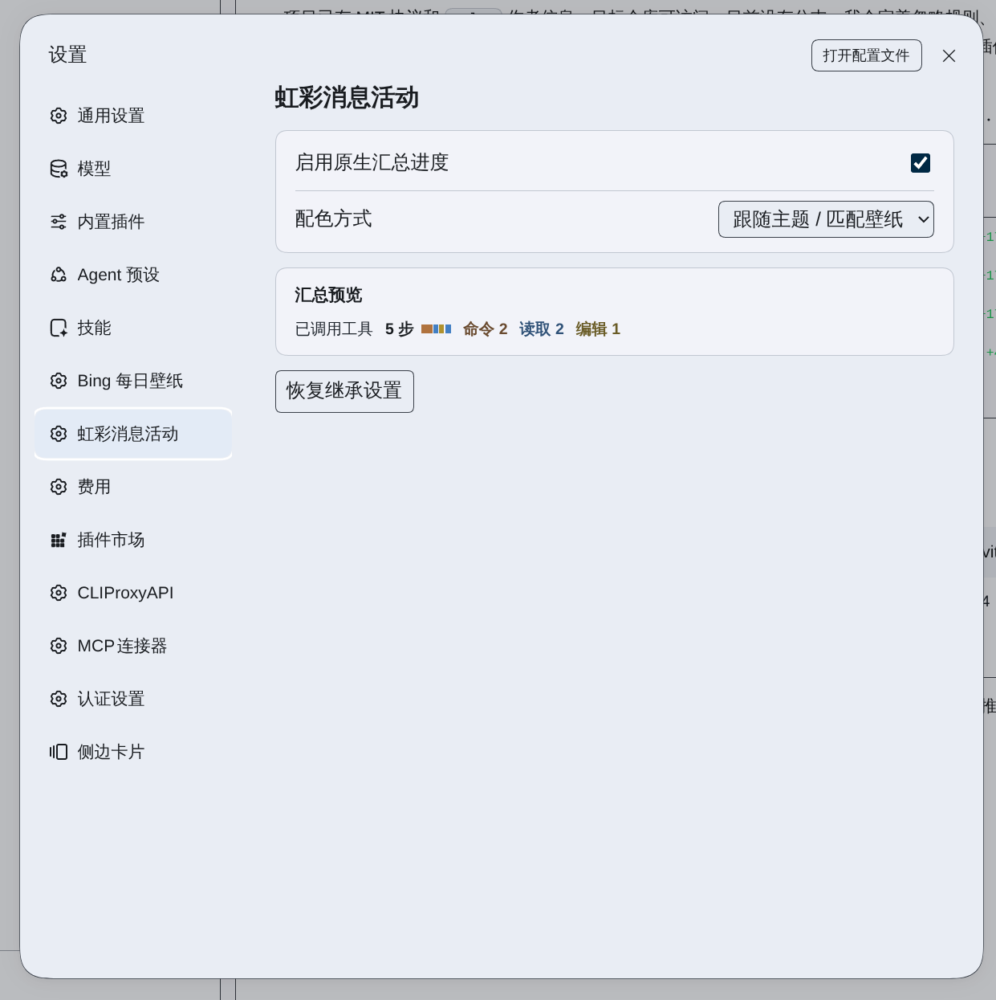

# dsh-rainbow-activity

Author: **nzlov**

[简体中文](README.zh-CN.md)

Adds step counts, an execution-order colour strip, and a category legend to DSH Web’s **native turn, analysis, and tool summaries**. Adjacent steps of the same category share one colour block. Native messages and expand/collapse behaviour remain unchanged.



## Installation

Requires DSH Web `>=0.2.2-rc.4 <0.3.0-0`.

Run either command on the DSH host. Replace `web` with the name of your profile if you use a different one.

**From npm:**

```sh
dsh plugin --profile web add dsh-rainbow-activity
```

**From the GitHub `main` branch:**

```sh
dsh plugin --profile web add 'git+https://github.com/nzlov/dsh-rainbow-activity.git#main'
```

If DSH Web is already running, restart it and refresh the page, then choose a palette in **Settings → Rainbow Activity**.

You can also open **Plugins → Add plugin** in the DSH sidebar, enter the npm package name or the GitHub address above, and click **Enable now** after installing.

### From a local package

```sh
git clone https://github.com/nzlov/dsh-rainbow-activity.git
cd dsh-rainbow-activity
npm pack
```

Enter the generated `.tgz` file's absolute path in **Add plugin**. If the browser is on a different machine, use a path accessible to the DSH host.

## Colours

Choose preset category colours, nine custom accents (thinking, read, search, write, edit, command, web, agent, and other), or theme matching. The native activity kinds map to these accent families. Theme matching mixes category colours with DSH's public semantic accent while preserving differences between categories.

Theme matching also follows the wallpaper when dynamic colours from `@nzlov/dsh-bing-wallpaper` are active. Otherwise it uses the standard DSH theme.

## Development

Build and check from the project root:

```sh
npm run build
npm run check
```

Run the build after changing client sources to regenerate `client.js`.

Tests reuse a compatible DSH installation. On Linux or macOS, if the project does not already have `node_modules/@deepseek-ai`:

```sh
DSH_DIR="${DSH_INSTALL_DIR:-$(npm root -g)/@deepseek-ai/dsh}"
test -d "$DSH_DIR/node_modules/@deepseek-ai" && \
  mkdir -p node_modules && \
  ln -s "$DSH_DIR/node_modules/@deepseek-ai" node_modules/@deepseek-ai && \
  npm test
```

Set `DSH_INSTALL_DIR` to the DSH package directory if it is installed elsewhere. If the dependencies are already linked, run `npm test` directly. The dependency link is neither committed nor packaged.

[MIT License](LICENSE) · Copyright © 2026 nzlov.
