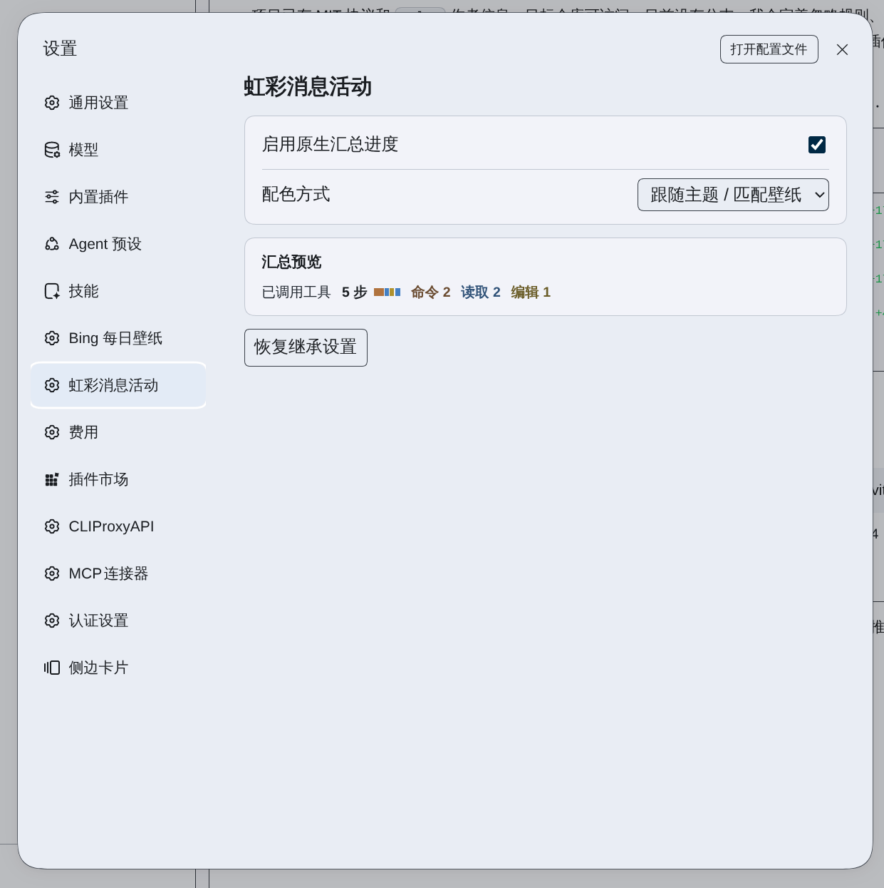

# dsh-rainbow-activity

作者：**nzlov**

为 DSH Web 的**原生回合、分析和工具汇总**添加步数、按执行顺序排列的彩虹条和分类计数。相邻同类步骤合并为一个色块，原生消息和展开／收起行为不变。



## 安装

需要 DSH Web `>=0.2.2-rc.4 <0.3.0`。

在运行 DSH 的机器上执行以下任一命令。若使用的不是默认 Web 配置，请把 `web` 换成实际的 profile 名称。

**从 npm 安装：**

```sh
dsh plugin --profile web add dsh-rainbow-activity
```

**从 GitHub 安装 `main` 分支：**

```sh
dsh plugin --profile web add 'git+https://github.com/nzlov/dsh-rainbow-activity.git#main'
```

如果 DSH Web 已在运行，安装后重启服务并刷新页面，然后在 **设置 → 虹彩消息活动** 选择配色。

也可以在 DSH 侧栏打开 **插件 → 添加插件**，输入 npm 包名或上方的 GitHub 地址，安装后点击 **立即启用**。

### 从本地安装包安装

```sh
git clone https://github.com/nzlov/dsh-rainbow-activity.git
cd dsh-rainbow-activity
npm pack
```

在 **添加插件** 中填入生成的 `.tgz` 文件绝对路径。若浏览器与 DSH 服务不在同一台机器，请使用 DSH 服务端可访问的路径。

## 配色

1. **彩色分类**：使用预设分类色。
2. **自定义分类色**：可分别设置思考、读取、搜索、写入、修改、命令、网络、子任务与其他九种分类色；原生活动类别映射到这些配色组。
3. **跟随主题 / 匹配壁纸**：将分类色与 DSH 公开主题强调色混合，跟随主题同时保留分类差异。

若 `@nzlov/dsh-bing-wallpaper` 的动态取色已生效，跟随主题时也会匹配壁纸；否则使用普通 DSH 主题。

## 开发

在项目根目录构建并检查：

```sh
npm run build
npm run check
```

修改客户端源码后，用构建命令重新生成 `client.js`。

测试复用兼容的 DSH 安装。以下是在 Linux / macOS 上、项目尚无 `node_modules/@deepseek-ai` 时的准备方式：

```sh
DSH_DIR="${DSH_INSTALL_DIR:-$(npm root -g)/@deepseek-ai/dsh}"
test -d "$DSH_DIR/node_modules/@deepseek-ai" && \
  mkdir -p node_modules && \
  ln -s "$DSH_DIR/node_modules/@deepseek-ai" node_modules/@deepseek-ai && \
  npm test
```

如果 DSH 安装在别处，先将 `DSH_INSTALL_DIR` 指向 DSH 包目录；已有可用的依赖链接时，直接运行 `npm test`。依赖链接不随源码或安装包发布。

[MIT 协议](LICENSE) · 版权所有 © 2026 nzlov。
